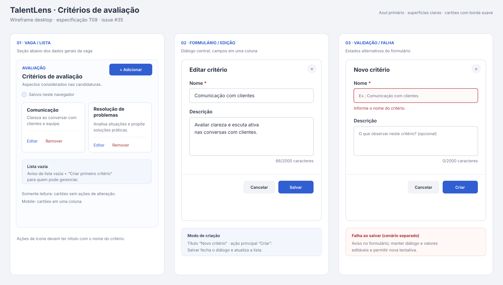

# Interface de critérios de avaliação

Especificação visual e funcional do T09 para a issue [#35](https://github.com/TalentLens-SisDib/TalentLens/issues/35). O wireframe é esquemático; ele define a estrutura da tela, sem propor uma nova identidade visual.

## Contexto e escopo

Os critérios descrevem aspectos considerados na avaliação das candidaturas de uma vaga. A interface fica na página de detalhes da vaga, logo após os dados gerais, como uma seção chamada **Critérios de avaliação**.

Este documento especifica a listagem, criação, edição, estados de carregamento e falha, permissões de interface, comportamento responsivo e requisitos de acessibilidade. Ponderação, pontuação e fórmulas de avaliação não fazem parte desta entrega. A remoção já aparece como ação secundária nos cartões da implementação T10; seu fluxo não é definido aqui.

## Estrutura e conteúdo

| Elemento | Comportamento definido |
| --- | --- |
| Cabeçalho da seção | Rótulo “Avaliação”, título “Critérios de avaliação” e texto curto explicando que os aspectos serão considerados na avaliação das candidaturas. |
| Ação principal | “Adicionar critério”, no cabeçalho para quem pode gerenciar. Quando a lista está vazia, oferecer também “Criar primeiro critério”. |
| Cartão de critério | Mostrar nome e descrição opcional em texto simples, preservando quebras de linha. Em telas largas, usar duas colunas; em telas estreitas, uma coluna. |
| Ações do cartão | Para quem pode gerenciar, mostrar editar e remover. Dar nome acessível a cada botão de ícone, incluindo o nome do critério. |
| Nota de armazenamento | Enquanto a persistência for local, informar “Salvos neste navegador”. Remover ou atualizar essa nota quando a API compartilhada estiver disponível. |

### Estados da lista

| Estado | Apresentação e ação |
| --- | --- |
| Carregando | Indicador de progresso com “Carregando critérios...”. |
| Falha ao carregar | Aviso com o erro e a ação “Tentar novamente”. |
| Vazia, com permissão | Informar que não há critérios para a vaga e oferecer “Criar primeiro critério”. |
| Vazia, somente leitura | Informar que não há critérios cadastrados, sem ações de edição. |
| Com critérios, com permissão | Cartões com ações de edição e remoção. |
| Com critérios, somente leitura | Os mesmos cartões sem ações de alteração. |

## Criar e editar

Abrir um diálogo central sobre a página da vaga. O formulário usa uma coluna, título contextual e ações no rodapé do diálogo. A edição preenche os valores atuais.

| Campo | Regras e apresentação |
| --- | --- |
| **Nome** | Obrigatório; remover espaços no início e no fim; até 200 caracteres. Exemplo de placeholder: “Ex.: Comunicação com clientes”. Mostrar erro junto ao campo quando estiver vazio ou exceder o limite. |
| **Descrição** | Opcional; remover espaços no início e no fim; até 2.000 caracteres. Usar área de texto com algumas linhas e contador “0/2000 caracteres”. Placeholder: “O que observar neste critério? (opcional)”. |

No modo de criação, o diálogo tem título **Novo critério**, botão principal **Criar** e botão secundário **Cancelar**. No modo de edição, usa **Editar critério**, **Salvar** e **Cancelar**. Indicar campos obrigatórios com asterisco e texto, além da semântica de campo obrigatório.

Depois de salvar com sucesso, fechar o diálogo, atualizar a lista e confirmar a ação com uma mensagem breve. Durante o salvamento, indicar progresso e impedir envios duplicados. Cancelar ou fechar descarta as alterações ainda não salvas.

### Validação e falhas

- Validar o nome após remover espaços externos; não aceitar valor vazio e respeitar o limite de 200 caracteres.
- Validar a descrição até 2.000 caracteres e manter o contador visível.
- Mostrar a mensagem de validação junto ao campo correspondente. Marcar o campo inválido e associar a mensagem ao controle.
- Após um envio inválido, levar o foco ao primeiro campo com erro.
- Se ocorrer erro de armazenamento ou da API, manter o diálogo aberto, preservar todos os valores digitados e mostrar um aviso no formulário com opção de tentar salvar novamente.
- Se a lista falhar ao carregar, manter o contexto da seção e oferecer recarga.

## Permissões e adaptação

O criador da vaga e usuários administradores podem criar, editar e remover critérios. Outros usuários visualizam a lista sem controles de alteração. Essa regra de interface segue a permissão da vaga; a API futura deve validar as mutações no servidor.

Em desktop, os cartões podem ocupar duas colunas dentro da largura disponível da seção. Em celular, usar uma coluna, permitir quebra de nomes longos e manter campos e botões dentro da largura da tela. O diálogo deve caber na área visível, rolar verticalmente quando necessário e manter os botões acessíveis sem rolagem horizontal.

## Acessibilidade

- Usar um elemento de seção com nome acessível, título hierárquico e controles com rótulos visíveis.
- Dar aos botões de ícone nomes contextualizados, como “Editar critério Comunicação com clientes”.
- Ao abrir o diálogo, mover o foco para o formulário; ao fechá-lo, devolver o foco ao controle que o abriu.
- Permitir navegação por teclado, fechamento por Cancelar e Escape, e foco visível nos controles.
- Associar erros aos campos e anunciá-los às tecnologias assistivas; não depender só da cor para indicar erro ou obrigatoriedade.
- Em telas estreitas e com zoom, manter leitura e operação sem rolagem horizontal.

## Critérios de aceite

- [ ] A seção aparece abaixo dos dados gerais da vaga, com estados vazio, carregando, erro e lista preenchida.
- [ ] Pessoas autorizadas encontram ações para criar e editar; demais usuários veem somente o conteúdo.
- [ ] Criar e editar usam o mesmo formulário, com título e ação principal adequados ao contexto.
- [ ] Nome e descrição obedecem aos limites de 200 e 2.000 caracteres; descrição é opcional e tem contador.
- [ ] Validação é apresentada junto ao campo. Falha ao salvar mantém diálogo e valores para nova tentativa.
- [ ] Cartões fluem de duas colunas no desktop para uma no celular, sem cortes ou rolagem horizontal.
- [ ] Diálogo, ordem de foco, retorno de foco, rótulos e mensagens de erro atendem aos requisitos de acessibilidade acima.
- [ ] Se a persistência ainda for local, a interface informa que os dados ficam salvos neste navegador.

## Referências de implementação

- [T10 — implementação da seção e formulário, PR #24](https://github.com/TalentLens-SisDib/app/pull/24), consultada como referência visual e de comportamento.
- [T12 — API de critérios, issue #29](https://github.com/TalentLens-SisDib/TalentLens/issues/29), responsável pela persistência compartilhada.

O T10 atualmente salva no navegador e exibe essa informação. A nota de armazenamento deve permanecer enquanto a API do T12 não substituir essa persistência. Os requisitos de foco e acessibilidade deste documento são critérios para revisão da implementação; a consulta ao T10 não representa uma auditoria de conformidade.
